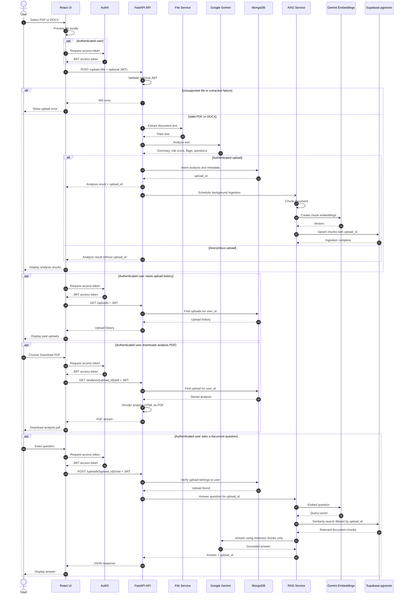

# SynopSpy Sequence Diagram

The diagram shows the primary user journeys: document upload and analysis, authenticated persistence and background RAG ingestion, analysis PDF download, and document-scoped chat.

## Main Contracts

- `POST /upload` accepts PDF and DOCX files and permits anonymous analysis.
- Authenticated uploads are stored in MongoDB and receive an `upload_id`.
- RAG ingestion runs as a FastAPI background task after the upload response is prepared; MongoDB `rag_status` moves from `pending` → `ready`/`failed`.
- Chat UI polls `GET /uploads/{upload_id}/rag-status` and stays gated until `ready`.
- Re-opening a past upload calls `POST /uploads/{upload_id}/ensure-rag` to (re)index when needed.
- `POST /uploads/{upload_id}/chat` is authenticated, rejects non-ready indexes, and filters vector retrieval by `upload_id`.
- `GET /analysis/{upload_id}/pdf` is authenticated and verifies ownership before generating the PDF.
- Vector storage uses Supabase **vecs** (`contract_documents`); enable the `vector` extension only.
